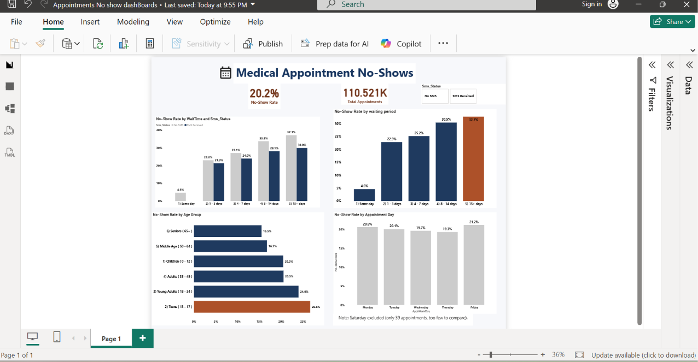

# Medical Appointment No-Show Analysis

## 1. Project Overview

This project analyses medical appointment attendance to understand the factors associated with patients missing scheduled medical appointments.

Using a dataset of **110,521 medical appointment records**, the analysis explores patient demographics, appointment scheduling patterns, waiting periods, SMS reminders and attendance behaviour.

The goal is to uncover meaningful patterns and provide actionable insights that can help healthcare providers improve appointment attendance and operational efficiency.

## 2. Business Problem

Missed medical appointments create challenges for healthcare facilities. They can waste valuable medical resources, increase operational costs, disrupt scheduling and delay access to care for other patients.

This project investigates patterns associated with patient no-shows to help healthcare providers better understand attendance behaviour and identify opportunities to improve appointment management.

## 3. Project Objectives

- Calculate the overall appointment no-show rate.
- Identify patterns in patient attendance.
- Examine the relationship between waiting periods and missed appointments.
- Investigate differences in no-show rates across age groups.
- Explore the relationship between SMS reminders and appointment attendance.
- Examine weekday attendance patterns.
- Present findings through an interactive Power BI dashboard.
- Develop data-driven recommendations for improving appointment attendance.

## 4. Tools and Technologies

- **Microsoft Excel:** Initial data exploration and analysis.
- **Power Query:** Data cleaning and transformation.
- **Power BI:** Dashboard development and visualisation.
- **DAX:** Measures and analytical calculations.

## 5. Dataset Description

The dataset contains **110,521 medical appointment records**.

It includes information about:

- Patient demographics and age.
- Appointment scheduling dates.
- Scheduled appointment dates.
- Medical conditions and health indicators.
- SMS reminder status.
- Appointment attendance status.

The dataset was used to investigate factors associated with missed appointments and identify patterns across different patient and scheduling categories.

## 6. Project Workflow

1. **Data Exploration:** Examined the dataset structure, columns and available records.
2. **Data Cleaning:** Reviewed and prepared the data for analysis.
3. **Data Transformation:** Used Power Query to organise and transform relevant fields.
4. **Data Analysis:** Investigated attendance patterns and calculated key performance indicators.
5. **Dashboard Development:** Created an interactive Power BI dashboard.
6. **Insight Generation:** Interpreted the findings and developed practical recommendations.

## 7. Dashboard Preview

The dashboard provides an overview of appointment attendance, overall no-show rate, waiting-period patterns, age-group comparisons, SMS reminder comparisons and weekday attendance.

## 8. Key Performance Indicator

| Metric | Result |
|---|---:|
| Total Appointments | 110,521 |
| Overall No-Show Rate | 20.2% |
| Approximate No-Show Appointments | 22,315 |

## 9. Key Findings

The analysis revealed several patterns associated with missed medical appointments.

### 9.1 Waiting Period

No-show rates increased as the waiting period between scheduling and the appointment date became longer.

| Waiting Period | No-Show Rate |
|---|---:|
| Same Day | 4.6% |
| 1–3 Days | 22.9% |
| 4–7 Days | 25.2% |
| 8–14 Days | 30.5% |
| 15+ Days | 32.7% |

Appointments scheduled 15 or more days in advance recorded the highest no-show rate, while same-day appointments recorded the lowest.

### 9.2 Age Group

The dashboard revealed differences in appointment attendance across age groups.

- Young adults (18–34) recorded a no-show rate of approximately 24.0%.
- Seniors (65+) recorded the lowest rate at approximately 15.5%.
- Children and adult age groups also showed varying attendance patterns.

These differences suggest that patient age may be a useful factor when developing targeted engagement strategies.

### 9.3 SMS Reminders

The dashboard comparison suggests that patients who received SMS reminders had lower no-show rates across the displayed waiting-period categories compared with patients who did not receive reminders.

This indicates an association between SMS reminders and appointment attendance. However, the analysis does not establish that reminders alone caused the difference.

### 9.4 Appointment Weekday

The weekday comparison revealed variations in no-show rates across the working days.

Friday recorded the highest displayed no-show rate at approximately 21.7%, while Thursday recorded the lowest at approximately 19.3%.

Saturday was excluded from the comparison because it had only 39 appointments.

## 10. Business Insights

The findings highlight several important considerations for healthcare appointment management:

- **Waiting time matters:** Longer gaps between booking and appointments are associated with higher no-show rates.
- **Patient demographics matter:** Attendance patterns differ across age groups.
- **Communication is important:** SMS reminders are associated with lower no-show rates in the displayed comparisons.
- **Scheduling patterns matter:** Differences across weekdays may provide opportunities to improve appointment planning.

These insights can help healthcare facilities make more informed decisions about patient communication and appointment scheduling.

## 11. Recommendations

Based on the analysis, the following actions are recommended:

1. **Reduce Long Waiting Periods:** Explore opportunities to shorten the time between appointment booking and consultation.
2. **Strengthen Reminder Systems:** Improve reminder communication, especially for appointments scheduled further in advance.
3. **Target High-Risk Groups:** Develop appropriate engagement strategies for age groups with relatively high no-show rates.
4. **Review Appointment Scheduling:** Investigate weekday attendance patterns and identify opportunities to improve scheduling efficiency.
5. **Monitor Attendance Regularly:** Track no-show rates over time to evaluate the effectiveness of interventions.

## 12. Limitations

- The analysis identifies associations and patterns but does not establish causation.
- Some demographic and scheduling factors may influence attendance in ways not captured by the available dataset.
- The relatively small number of Saturday appointments limits meaningful comparison with other weekdays.
- The findings reflect the dataset analysed and may not represent every healthcare facility.

## 13. Conclusion

This project demonstrates how data analytics can transform raw healthcare appointment records into meaningful insights.

Through data cleaning, transformation, analysis and visualisation, the project identified patterns associated with missed appointments, particularly waiting periods, age groups, SMS reminders and weekday scheduling.

The findings provide a foundation for data-driven recommendations that could help healthcare providers improve appointment management, patient engagement and operational efficiency.

---

## Project Information

**Project:** Medical Appointment No-Show Analysis  
**Analyst:** Tolulope Akinrombi  
**Tools:** Excel, Power Query, Power BI and DAX  
**Project Type:** Data Analytics and Visualisation
